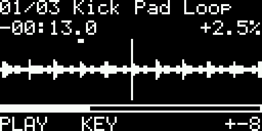
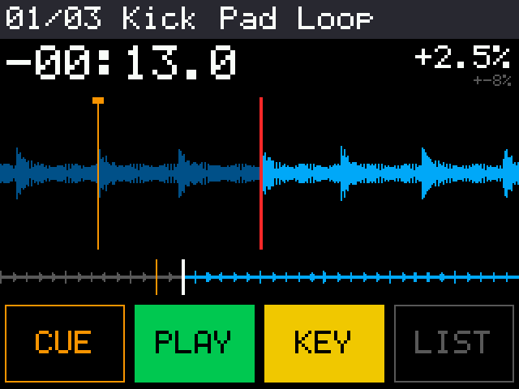

# freedj-nano

A DJ deck for the smallest ESP32s: **one core, no FPU, no PSRAM** (ESP32-C6 first). The
little sibling of [freedj-esp](../freedj-esp), which needs two cores, an FPU and PSRAM (P4,
S3, A1S). The two repos share the deck's vocabulary (`deck::Event`, the DJ2Go map) but not
the engine: everything here is fixed-point and allocation-free in the audio path.

Status (2026-11-10): **runs and plays audio on the XIAO ESP32C6** through a PCM5102A. It
boots, maps the tracks, and plays, cues and keylocks from the serial console at
5 % of the core. The portable core passes its host tests (keylock pitch, speed and level,
click-free transitions, the UI layouts); the firmware builds for three configs.

Why it's built this way, the measurements and the wrong turns: [docs/DESIGN.md](docs/DESIGN.md).

## What's here

| | |
|---|---|
| **Keylock** (`stretch.cpp`) | WSOLA in fixed point, reading straight from memory-mapped PCM, so no input or overlap buffers: two frames at 50 % overlap, a sin² window whose halves sum to exactly 1, coarse-then-fine AMDF search on mono. About 40 bytes of state. 0.5–2× speed; outside that (and while scratching) it's varispeed |
| **Varispeed** | Linear interpolation at a Q16.16 position: any speed, reverse, scratch crawl |
| **Deck** (`deck.cpp`) | CDJ transport (PLAY, CUE with preview), tempo fader and ranges (±6/10/16/50 %), keylock, jog: nudge while playing, scrub while stopped, scratch while touched. Every jump (cue, load, play, stop, engine switch) is a one-block crossfade, so nothing clicks. Lock-free event queue from the control task, seqlock status for the UI |
| **Tracks** (`library.cpp`, `tools/pack_tracks.py`) | A pack of 16-bit PCM plus 10 ms peak tables, flashed into a partition and memory-mapped: loading a track is pointer arithmetic |
| **MIDI** (`midi.cpp`, `dj2go.cpp`) | Byte-stream parser (running status, real-time, SysEx) for DIN/TRS MIDI on a UART, and freedj-esp's DJ2Go map. The C6 has no USB host: a USB controller needs a USB-to-DIN host box, or BLE-MIDI later |
| **Screens** (`gfx.cpp`, `ui.cpp`) | One small drawing interface, a built-in 5×7 font, three layouts by size: 128×32, 128×64, and color 320×240 / 480×320 with touch buttons and drag-to-scratch on the waveform |
| **Firmware** (`firmware/`) | ESP-IDF 5.5, ESP32-C6: I2S to a PCM5102A, EC11 on PCNT, buttons (GPIO or one-pin resistor ladder), pitch pot, MIDI UART, display backends |

### Displays

| Backend | Panels | How |
|---|---|---|
| `display_u8g2.cpp` | SSD1306 128×64 (0.96"), SH1106 128×64 (1.3"), SSD1306 128×32 (0.91") | [u8g2](https://github.com/olikraus/u8g2) as the controller driver and frame buffer, on I2C. Any other u8g2 panel (SSD1309, ST7567, ...) is one more `Setup` line. u8g2 is only the driver: the UI and font are ours, so it could be swapped out |
| `display_tft.cpp` | ILI9341 320×240 (the 2.8" and 3.2"), ST7796 480×320 (the 4"), FT6336 touch | ESP-IDF `esp_lcd` over SPI, no LVGL. No frame buffer: the screen is drawn in 16-row bands into two DMA buffers, and a band is sent only if it changed (hash per band) |

The ST7796 runs on the ILI9341 driver with its own init sequence, because Espressif's ST7796
component doesn't list the C6 as a target.

## Screens

| 128×64 OLED | 2.8" TFT |
|---|---|
|  |  |

Rendered on the host by the tests (`build/tests/out/*.ppm`), from the same code the firmware runs.

## Boards

Pin maps are in `firmware/main/board.h`. **Not checked on hardware yet.**

**Seeed XIAO ESP32C6, with the 3.2" touch TFT** (`xiao_tft`): runs on the bench at 28.5 fps,
17.6 ms per frame at 40 MHz SPI (the A1S manages 7 fps on the same panel: its screen lines are
shared). The screen takes the encoder's pins, so touch does jog and browse: SCK D8, MOSI D10,
CS D3, DC D9, touch SDA D4 / SCL D5; panel RST, LED and CTP_RST to 3V3, VCC to 5V; I2S BCK D1,
LRCK D2, DIN **D6**; ladder D0; MIDI D7.

**Seeed XIAO ESP32C6 with an OLED** (`xiao_oled`, the default): OLED + encoder:

| Pin | Use |
|---|---|
| D1 / D2 / D10 (GPIO 1 / 2 / 18) | I2S BCK / LRCK / DIN to the PCM5102A |
| D4 / D5 (22 / 23) | I2C SDA / SCL: OLED |
| D8 / D9 / D3 (19 / 20 / 21) | EC11 A / B / push |
| D0 (0, ADC) | 4 buttons on a ladder: 10k to 3V3, then PLAY 0R, CUE 2k2, KEY 4k7, LIST 10k to GND |
| D7 (17) | MIDI in (UART1 RX, via an optocoupler) |
| D6 (16) | spare |

**ESP32-C6-DevKitC-1** (`devkit_tft` for the 2.8"/3.2", `devkit_tft4` for the 4"): TFT SCK 6,
MOSI 7, CS 18, DC 19, RST to 3V3; touch and OLED on I2C 22/23; I2S 10/11/21; EC11 3/5,
push on 9 (the BOOT button); PLAY 0, CUE 1, KEY 2; pitch pot on 4; MIDI in on 20.

**PCM5102A** breakout: SCK to GND (no MCLK: its PLL runs off BCK, which is set to 64 fs),
XSMT high, FMT low. Line out only; a headphone amp is a separate board.

## Controls

| | |
|---|---|
| Encoder | Jog: nudge while playing, scrub while stopped |
| KEY + encoder | Tempo (boards without a pot). KEY tap: keylock |
| Push or LIST | Track list. In the list, the encoder browses and push loads |
| PLAY, CUE | As on a CDJ: CUE while playing returns to the cue and pauses; CUE while paused sets the cue and previews while held; PLAY during a preview keeps playing |
| Touch (TFT) | CUE / PLAY / KEY / LIST buttons; drag the waveform to scratch |
| MIDI | The DJ2Go map: either deck's controls drive the one deck |
| Controller on the computer | freedj-esp's `tools/midi_bridge.py --port /dev/ttyACM0` forwards a USB controller (the DJ2Go) over the serial port: 0x01 + a USB-MIDI packet, decoded with the DJ2Go map |
| Serial console | Over the USB port, for the bench: `p` play, `c` cue (tap), `k` keylock, `+` / `-` tempo 1 %, `0` tempo 0, `r` range, `n` / `b` next / previous track, `j` / `J` jog, `l` list, `?` help. Keys sent while it boots are lost (opening the port resets the C6) |

## Build

```sh
tools/build.sh                          # all firmware configs (Docker, ESP-IDF 5.5) + host tests
tools/build.sh devkit_tft               # one config
cmake -S tests -B build/tests && cmake --build build/tests && (cd build/tests && ./nano_tests)
```

Host tests write listening files (`out/keylock_080.wav`, `keylock_125.wav`, `deck_session.wav`)
and screenshots of every layout.

## Flash

```sh
cd firmware/build_xiao_oled && esptool --chip esp32c6 -b 460800 write-flash @flash_args
tools/pack_tracks.py music/*.mp3 -o tracks.bin     # 22.05 kHz mono; --stereo, --rate 32000
esptool --chip esp32c6 write-flash 0x180000 tracks.bin
```

The `tracks` partition is 2.5 MB on a 4 MB board: about 60 s of 22.05 kHz mono. Fine for
bring-up; storage is the first thing to grow (see the roadmap).

## Budget

| | xiao_oled | devkit_tft |
|---|---|---|
| App image | 269 KB (82 % of the partition free) | 312 KB |
| Static RAM (DIRAM) | 69 KB of 452 KB | 79 KB |
| Audio CPU, 22.05 kHz mono | stopped 0.5 %, playing 1.4 %, **keylock 5.0 %** (XIAO, 160 MHz) | |
| Audio CPU, 44.1 kHz stereo | playing 3.1 %, **keylock 16.4 %, worst block 34 % of its deadline, 0 dropouts** (with the TFT at ~43 fps) | |
| Free heap while playing | 424 KB | |

The firmware prints a budget line every 2 s: audio % of the core (and which engine), UI ms per
frame, free heap.

## Roadmap

1. **Bench bring-up** on the XIAO: audio out, the budget line, encoder and ladder.
2. **More music:** stream from microSD instead of flash (needs a small read-ahead cache for
   the keylock's random access), or IMA ADPCM in the pack (4:1, block-wise so it stays
   seekable).
3. **BLE-MIDI**, since the C6 has no USB host.
4. **New chips** ([docs/TARGETS.md](docs/TARGETS.md)): the **RP2350** as the second real
   target (two cores, memory-mapped flash, PIO I2S, USB host for rekordbox sticks), and the
   **CH32V003** (10 cents, 2 KB RAM, PWM audio) as a how-small-can-it-go experiment
   ([the 10-cent deck plan](docs/DECK10C.md)). First
   step: cross-compile the engine and count cycles per sample.
5. Beetle ESP32-C6 pin map; the C3/H2.

## License

GPL-3.0-or-later, as freedj-esp. `deck_event` and `dj2go` are copied from freedj-esp
(2026-11-08). u8g2 is BSD-2-Clause; the Helvetica bitmap fonts in `fonts.cpp` are Adobe / DEC under the X11
license; the ST7796 init sequence is from Espressif's
esp_lcd_st7796 (Apache-2.0).
