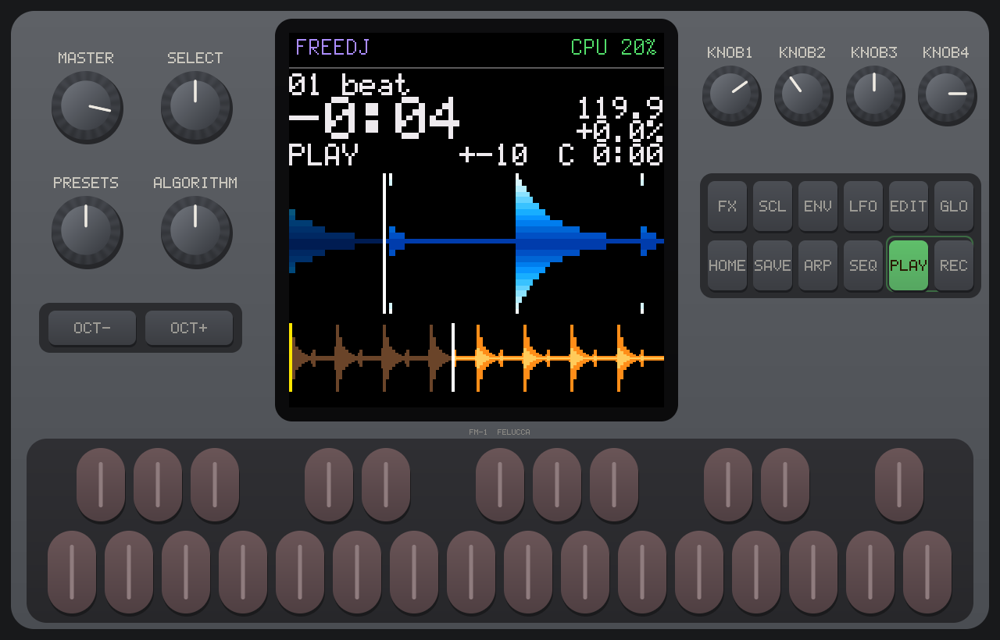

# The deck on an M-VAVE FM-1

The same firmware as the CH32V003 and the PY32 (`../fw/`, unchanged), as a module for
[fm1-dock](https://github.com/joakimeriksson/fm1-dock) on M-VAVE's FM-1 pocket synth, and in
[fm1-emu](https://github.com/joakimeriksson/fm1-emu), the emulator of it. fm1-dock is a
community base firmware that keeps the FM-1's USB, installer and rescue, and runs one module
at a time; `hal_fm1.c` is this deck's `hal.h` on fm1-dock's module interface
(`firmware/dock/hb_module.h`).

Status (2026-11-25): runs on a real FM-1 (fm1-dock 0.9.0) and in fm1-emu: plays, jogs, browses, loads,
keylock. Two builds: `make fm1` with a short clip in the module's flash, and `make fm1-usb` with the
tracks streamed from the computer over USB (`tools/fm1host.py`, below), playing without glitches on the
FM-1.



What we found out about the FM-1 itself (the chip, its FPU, memory, interrupts, the screen, USB host mode,
the devices tried) is in [HARDWARE.md](HARDWARE.md).

## Controls

| FM-1 | The deck |
|---|---|
| SELECT | the jog (nudge while playing, scrub while paused) |
| FX + SELECT | opens the track list (SEL lights); then SELECT moves, SEL or PLAY loads, FX tapped closes it |
| EDIT | the encoder's push: keylock; loads in the list; FX + EDIT: tempo range |
| KNOB1 | tempo (the pitch pot) |
| SEQ | CUE (left of PLAY, as on a CDJ) |
| PLAY | PLAY |
| MASTER | volume (fm1-dock's) |
| MIDI IN | the DJ2Go map, as over the CH32's bridge |
| HOME held 1.5 s | fm1-dock's picker (another module) |

PLAY lights while playing, SEQ while previewing the cue. In fm1-live's window: Space PLAY, `0` SEQ (CUE),
`1` FX (SHIFT), `5` EDIT, Left / Right SELECT; so `1` held + Left / Right browses, `5` loads.

## How it maps

- **The panel's speed:** fm1-dock's `blit()` waits for the 12 MHz SPI (a waveform band ~10 ms) and the
  main loop is also where the USB frames are taken, so the waveform goes at 10 fps (USB build), drawn
  whole and sent a row pair a pass from its middle out (its two halves change together; there's no
  vsync), the other pages in 2-row strips: no pass over ~1 ms.
- **Screen:** `fw/ui.c` still talks to an SSD1306. `hal_i2c_send` keeps its 128 x 64 picture and
  each page that changed is laid out on the colour panel: the text pages scaled to 240 x 15, the
  waveform's three at 30 px each coloured by loudness (deep blue to white) and dimmed behind the
  playhead, the overview drawn from the track's own 128 columns at 44 px (orange ahead, brown
  behind, a white playhead, a yellow cue), the track list at 25 px a row.
- **Top line:** the deck's own (`HB_F_SCREEN`): its name and a CPU meter, the share of the time its
  main-loop work takes (decoding, keylock, the screen) on the 24 MHz counter. fm1-dock's own "%"
  there counts only the audio callback, ~0.4 % here. About 20 % while playing in fm1-emu's default
  timing; `FM1_STRICT=1` is the chip's.
- **Audio:** nano-lite at 22050 Hz into a 64-block ring (93 ms); `render()`, in fm1-dock's
  audio interrupt, plays it at 44.1 kHz with linear interpolation, the same on both channels.
- **Main loop:** `draw()`, which fm1-dock calls often, runs `app_step()`.
- **Tracks (`make fm1`):** the FM-1 has 1 MB of flash in all and no card slot. A clip in the
  module's own flash, on the simulator's emulated SD card, as the PY32's `MEMCARD=1` build does:
  about 8 s in a module's 272 KiB. `FM1_DEMO=file.wav FM1_DEMO_S=seconds` picks it.

## Tracks over USB (`make fm1-usb`, `make fm1-usb-live`)

The computer is the card: `tools/fm1host.py IMAGE` serves a card image from `tools/sdimage.py` to
the FREEDJ USB module over fm1-dock's USB-MIDI (`make fm1-usb-live` builds the image from
`FM1_MUSIC=` files, installs the module, opens fm1-live with its USB cable in and runs the host).

- The module asks with CCs on channel 16 (102..105 a block number, 106 a run, 108 a one-off,
  107 hello); the computer answers with fm1-dock MODULE frames (SysEx, `data()`).
- Before the deck starts, the blocks that aren't track data (FAT, directory, TRACKS.BIN's
  entries) are pinned. The track data comes into a 128 KB cache, 120 blocks (2.8 s) ahead of the
  deck; the waveform's peaks into a 32 KB cache of their own. A paused deck's position is fetched
  too, so PLAY starts with audio. A block not there plays silence.
- Each frame is half a block with its block number, followed by filler (fm1-dock's USB interrupt holds
  one frame until its main loop takes it, and drops one that starts arriving meanwhile): 48 events and
  4 frames in flight on an FM-1 (its queue), 32 and 16 in fm1-live. Nothing is resent by the computer:
  the module sees gaps in what came and asks again. Under fm1-dock a real FM-1's port is "Felucca";
  the host finds it (or fm1-live's) by itself.
- Rates: the deck plays 43 blocks a second (22 KB/s). fm1-dock's USB driver takes about one
  64-byte packet every half millisecond on the chip (one a millisecond in fm1-emu), ~2x what the
  deck needs with pipelining; more would need fm1-dock itself changed (its CDC channel, or polling
  faster). The module reports its CPU, main-loop passes and misses to the host each second.
- fm1-live's computer sends one USB packet a frame; `FM1_USB_OUT_PER_FRAME=8` (a local change to
  fm1-emu, crates/fm1-soc/src/usb.rs, not upstream) lets it send more, as a computer does.

## A USB stick (next)

Tried 2026-11-25 with `usbhost.c`, an fm1-dock probe (runs from RAM, never touches the flash): a countdown,
then the controller in host mode as JieLi's AC79 SDK driver does it, a watch for a device, its descriptor,
then the watchdog restarts the FM-1 and `tools/probe.py result` reads what it saw:

```
cd ~/sandbox/thirdparty/fm1-dock && uv run --with python-rtmidi tools/probe.py run \
  ~/sandbox/audiodestrukt/freedj-nano/ch32v003/fm1/probes/usbhost.c --on fm1 --args 20,20 --ms 90000
```

The controller takes the host role (DEVCTL 0x0F: session, host mode), but through an Apple USB-C
multiport adapter and a USB-C dock, both with a charger in, no device came up (D+ / D- low) and VBUS never
read valid: their hubs wait for 5 V from the host, which the FM-1 can't give. Next: a passive OTG adapter
with a charging input (no hub), or a Y-lead (the stick on 5 V, D+ / D- straight through).


The FM-1's USB controller (a Mentor MUSB core) can be a host, and JieLi's AC79 SDK has host and
mass-storage code. Untested: whether host mode works through the FM-1's USB-C port, and the stick's
5 V (the FM-1 almost certainly can't supply it: an OTG adapter with power pass-through, or a powered
hub, would). The plan: an fm1-dock probe (runs once from RAM, never touches the flash) that counts
down on the screen, switches the controller to host, and shows whether a stick appears and its
VID / PID. A stick would then stand in for the SD card's blocks, the deck above unchanged.

## Build and run

Needs fm1-dock, JieLi's Linux toolchain and fm1-emu:

```
git clone https://github.com/joakimeriksson/fm1-dock ~/sandbox/thirdparty/fm1-dock
(cd ~/sandbox/thirdparty/fm1-dock && tools/get_toolchain.sh)     # or set JIELI_TOOLCHAIN
git clone https://github.com/joakimeriksson/fm1-emu ~/sandbox/thirdparty/fm1-emu
(cd ~/sandbox/thirdparty/fm1-emu && cargo build --release -p fm1-live)   # Rust 1.95 or newer
mkdir -p ~/sandbox/thirdparty/fm1-dock/reference && cd ~/sandbox/thirdparty/fm1-dock/reference && \
  gh release download v0.9.0 -R joakimeriksson/fm1-dock -p fm1-dock-0.9.0-empty.fwsc

make fm1        # build/fm1/freedj.dock
make fm1-emu    # headless: build/fm1/emu/panel.png, audio.wav, log.txt (FM1_KEYS=, FM1_MS=)
make fm1-live   # a window: click the panel, Space is PLAY
```

The first `fm1-emu` or `fm1-live` installs the module through the emulated MIDI IN, which at
31250 baud takes ~80 s of emulated time (~35 s here), into `build/fm1/flash.bin`; later runs
boot from that with the module in place, until the module changes. `FM1_STRICT=1 make fm1-emu`
times it as the chip would.

The variables (`FM1_DOCK`, `FM1_LIVE`, `FM1_FWSC`, `JIELI_TOOLCHAIN`) default to the paths above.

`make fm1-emu` with a module this size needs fm1-dock's `tools/dock.py` to hand fm1-live the
deploy script as a file (`FM1_BENCH_KEYS=@file`) rather than in the environment, where 196 KB
doesn't fit: a five-line change in the local clone, not yet upstream.

## On a real FM-1

Install fm1-dock (its web installer, or `tools/fm1_install.py` with its package), then over USB:

```
cd ~/sandbox/thirdparty/fm1-dock && uv run --with python-rtmidi tools/dock.py deploy \
  ~/sandbox/audiodestrukt/freedj-nano/ch32v003/build/fm1/freedj.dock
```

Over USB that takes seconds. Holding OCT- at power-on always reaches fm1-dock's rescue. Stop
`tools/fm1host.py` before deploying; a build deployed over an older one at the same flash address has
crashed once right after starting (it restarts and runs).

## Still to do

- The USB stick: done (FREEDJ STICK), straight on a powered passive OTG adapter or behind a plain USB-A hub
  on one. Hubs: `usbmsc.c` powers each hub's ports, resets each occupied one, and gives every device its own
  address, hubs within hubs too (the cheap 7-port kind is two 4-port chips, the second on the first's port 1:
  seen on a 1a40:0101). A non-drive's port is switched off again. Full speed only, so hubs only pass the
  traffic through: reads run as fast as with the stick straight in. Behind a hub the root lines say nothing
  about the stick: a failed read asks the hub's port instead (so an idle deck notices a pulled stick only
  at its next read). Opening through two hubs takes a few seconds.
- **Revisit: the stick without poking fm1-dock's internals.** The first deck build takes the port by writing
  fm1-dock 0.9.0's own `usb.up` / `usb.detached` (their address from a build of its commit 5d16166, checked
  against the FM-1's flash), so its 2 kHz USB poll and its retry leave the controller alone. To work out
  before relying on it: it ties the module to that exact fm1-dock build (a check at start, or it refuses);
  The long open through hubs also feeds fm1-dock's 8 s watchdog itself (its P33 WDT_CON, as `fm1_wdt_feed()`
  does: modules aren't given a feed, probes are). What else touches the controller (the audio interrupt's `uac_service`, the deploy path, BLE); what the
  release must put back; the computer link gone while it runs (no deploy, the rescue still OCT- at power-on).
  The right thing: an fm1-dock API for a module to ask for the port as a host (and give it back), proposed
  upstream.
- USB-MIDI controllers in host mode (a DJ2Go straight in: class 01/03, its bulk IN read every ~10 ms with a
  NAK limit of a frame, into the same DJ2Go map), alongside the stick on a hub (the hub code skips it for
  now: each transfer would set FADDR to its device, one at a time).
- **DVS (relative): in FREEDJ STICK.** A USB audio interface on the port (a UCA202) and a Serato Control Vinyl
  into it: the side and the decoder flags found in the first half second (`vinyl_scan`), then the record's speed
  and direction drive the deck (`app_vinyl`), the tracks from the module's flash. The interface goes **straight
  on the FM-1's port**: behind the two cheap hubs its power LED stays off and its input is ~3x noisier (no lock;
  HARDWARE.md). Next: the position (the 3 MB table on the stick, then ABS / needle drops: `vinyl_follow`).
- **TODO: the hub and the stick with DVS.** (1) Done: a GL850G hub (05e3:0610) powers the UCA202 and DVS locks
  behind it (the cheap FE1.1 hubs starve it). (2) Built, not yet tested on the device: the stick, the DJ2Go and
  the interface sharing the bus, the audio stream paused around each stick read, hub check and DJ2Go poll (one
  FADDR). Check the log's hold count and longest hold. See USB-HUBS-AUDIO.md.
- **TODO: one FM-1 build.** FREEDJ (tracks in flash), FREEDJ USB (from the computer) and FREEDJ STICK (stick,
  DVS) into one module that picks at run time from what's there; the FM-1 has room for one deck build (flash:
  the built-in tracks alone are ~190 KB).
- Plain MP3s on the stick (a decoder on the FM-1; peaks made as it loads) besides TRACKS.BIN.
- Browsing on its own encoder (PRESETS), no FX to hold.
- The 27 keys: hot cues, loops.
- A layout of its own at 240 x 240 instead of the OLED's pages laid out.
