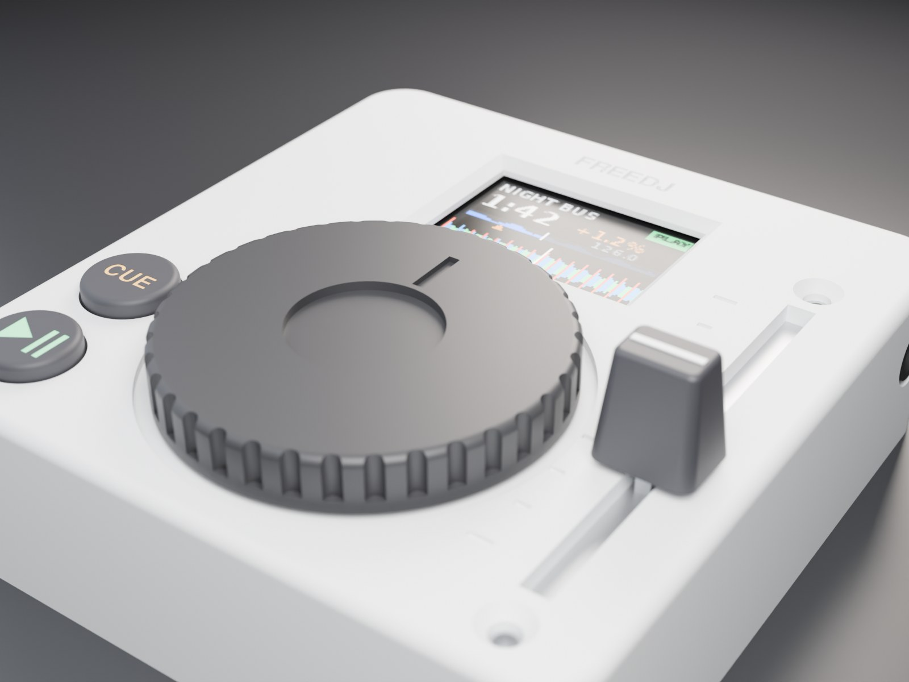
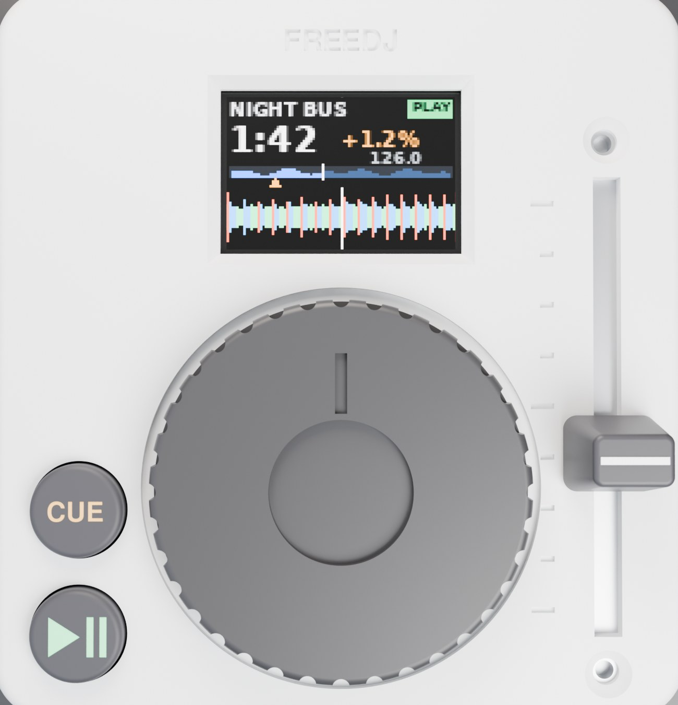
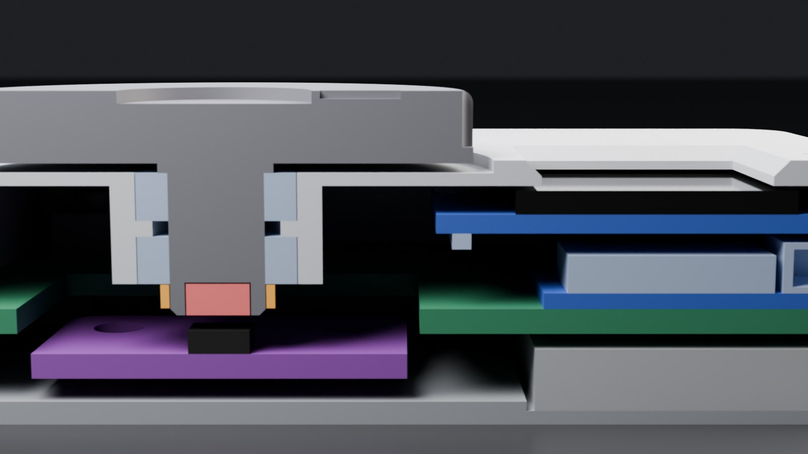
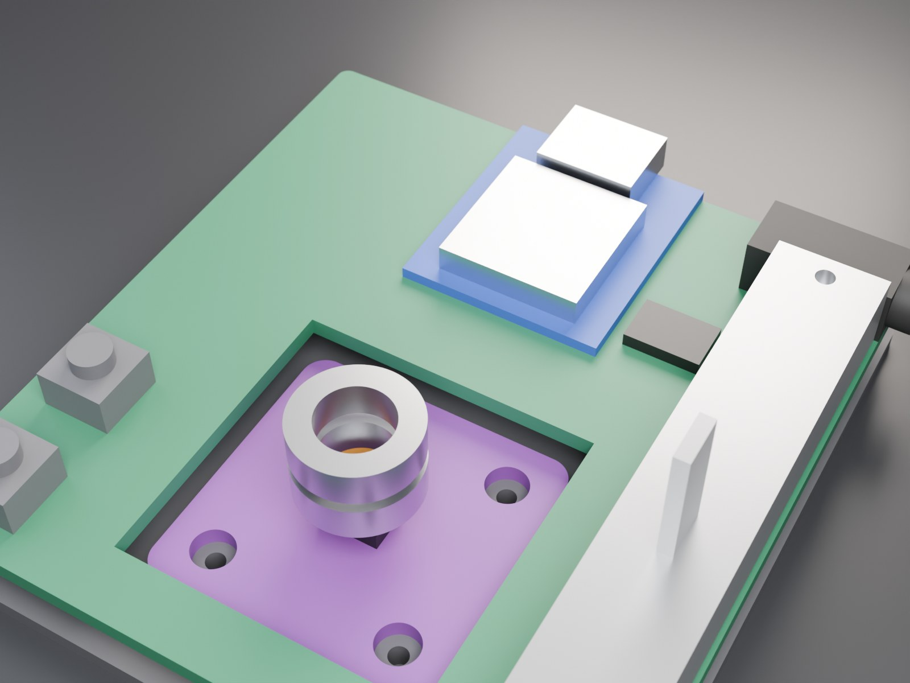
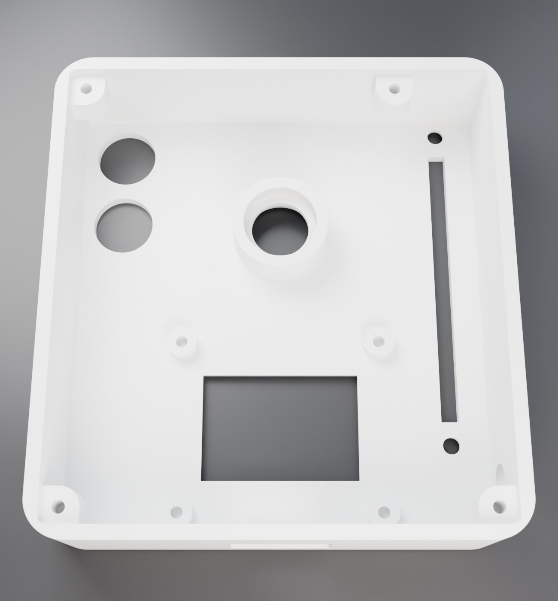

# Keychain deck

A pocket freedj deck: XIAO ESP32-S3 (plays tracks off a USB-C stick), 0.95" colour OLED,
32 mm jog on an AS5600, 35 mm pitch fader, CUE / PLAY, LiPo, headphone out.
**60 x 63.6 x 16.9 mm**; the platter stands 4.3 mm proud. (A keyring tab is in the CAD but
switched off: `KEYRING = True` in `params.py` adds it to the back-left corner.)

| Top | Section through the jog |
|---|---|
|  |  |
| **Inside (shell hidden)** | **Shell underside** |
|  |  |

CDJ layout: the screen over the jog, CUE above PLAY in the bottom-left corner, pitch down
the right. The width is CUE + jog + fader side by side; the length is buttons-and-jog plus
the screen behind them; the height is the OLED stacked over the XIAO. Getting much smaller
needs the AS5600 (and the jog over it) on our own PCB instead of the 23.8 mm breakout.

## Layout

| Part | Where | Notes |
|---|---|---|
| 0.95" SSD1331 OLED (generic 7-pin) | over the jog, glass behind a chamfered window | 4 M2 bosses on its holes; header on the edge toward the jog (the back edge is over the USB-C) |
| Jog, 32 mm (34.5 mm well) | beside CUE / PLAY, front edge in line with PLAY's (0.5 mm behind) | printed platter + 6 mm shaft, two MR106ZZ (6 x 10 x 3), glued collar, 4 x 2 diametric magnet 1.0 mm over the AS5600 |
| AS5600 breakout (23.8 mm, freedj-esp's) | on the base under the jog, in a well in the main PCB | wires soldered straight on (no headers: they'd need 14 mm each side) |
| CUE / PLAY, 8 mm caps | stacked in the bottom-left corner, CUE on top | sized to the jog the way freedj-esp's 22 mm caps are to its 100 mm jog; 6 x 6 x 5 mm SMD tact switches |
| 35 mm fader | right side, frame 0.3 mm off the front wall | frame up against the top's underside, 2 x M2 countersunk from above, pins soldered through the main PCB |
| XIAO ESP32-S3 | back, under the OLED, flat on the main PCB | USB-C out the back wall (stick, charging, flashing) |
| 402030 LiPo | under the main PCB, under the screen | pocket in the base; XIAO's BAT pads charge it |
| PCM5102A + 3.5 mm jack (PJ-320D style) | on the main PCB; jack out the right wall behind the fader | line-level out, as on the xiao-mini carrier |

Pins (XIAO S3 has 11): OLED SPI SCK / MOSI / DC (CS tied low, RES on the reset line) = 3,
AS5600 I2C = 2, I2S BCK / WS / DIN = 3, CUE + PLAY on one ADC ladder = 1, fader = 1. That's
10, leaving one spare (D6, also the UART TX for logs while the stick is in).

## Measure before printing

Every number marked `MEASURE` in `cad/params.py` came from a listing or a typical part, not
from the parts here. The ones that move things:

- **OLED board**: size (30.5 x 27.5 assumed), hole spacing (27 x 23), where the glass and
  its active area sit on the board (`OLED_GLASS_DY`, `OLED_AA_DY`, centred assumed),
  glass + tape thickness (1.5).
- **Fader**: frame (50 x 9 x 6.5, by the travel + 15 rule of the 45 and 60 mm ones), screw
  holes (M2, 46 apart; some have tabs instead),
  lever size and height above the frame (1.2 x 4, 10 mm). The knob grows with the lever:
  8.6 mm tall now. A 15 mm lever wants trimming to 10.
- **XIAO S3** height above its board (3.3 assumed for the USB-C).
- **Jack** body (12 x 6 x 5) and **LiPo** (4 x 20 x 30).

Change them in `params.py`, run `make`, and the fit check says if anything now collides.

## Print

`cd cad && make` writes `cad/build/`:

| File | Qty | Notes |
|---|---|---|
| `shell.stl` | 1 | upside down, no supports |
| `base.stl` | 1 | flat |
| `platter.stl` | 1 | upside down, shaft up |
| `collar.stl` | 1 | glue onto the shaft under the lower bearing |
| `cue_cap.stl`, `play_cap.stl` | 1 each | upside down; fill the icons with paint |
| `knob.stl` | 1 | socket down |
| `fit_gauge.stl` | optional | shaft sizes for the MR106 before printing the platter |

Hardware: 2 x MR106ZZ, 4 x 2 mm diametric magnet, 4 x M2 x 5 countersunk (base, into 1.6 mm pilots in the shell's bosses),
4 x M2 x 4 thread-formers (OLED), 4 x M2 x 4 (AS5600), 2 x M2 x 3 countersunk (fader).

## Buttons for prototyping

The holes are 8.4 mm. Until the printed caps are done, 6 x 6 tact switches with tall round
actuators (6 x 6 x 9.5) poke straight through. Another option is 12 x 12 switches with
their round caps, but those need `BTN_D` set to about 12 and the buttons moved apart.

## Open items

- **Main PCB**: not designed yet. The CAD reserves its outline (the whole inside, less the
  encoder well) at 5.9-7.5 mm. It carries the XIAO, the PCM5102A, the jack, the tact
  switches and the fader.
- **5 V for the stick on battery**: the XIAO has no boost, so on the LiPo alone a USB stick
  gets no power. The main PCB needs a small 5 V boost onto the XIAO's 5 V pin (check
  Seeed's schematic first: a diode between 5 V and VBUS would block it).

## Files

`cad/params.py` holds every dimension (frame: x across, y front to back, z up from the
underside). `shell.py`, `base.py`, `jog.py`, `controls.py` are the printed parts, and
`stock.py` holds stand-ins for the bought parts. `machine.py` places everything, checks
every pair of parts for overlap and exports `deck.glb`, `deck_cut.glb` and
`deck_inside.glb`. `render.py` renders them in Blender (`make renders`), and
`renders/INDEX.md` is the dated render log.
