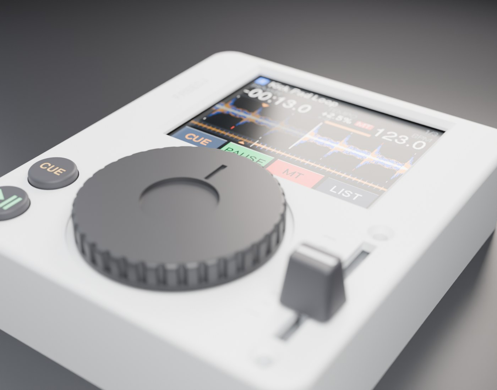
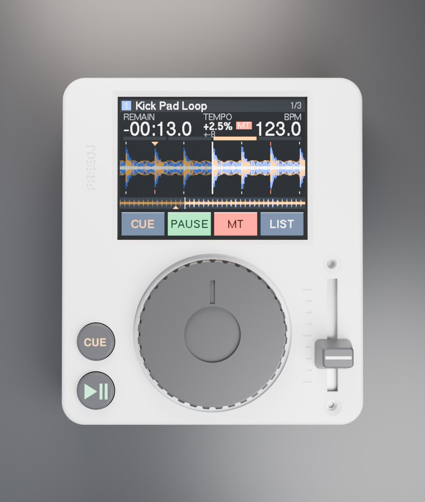
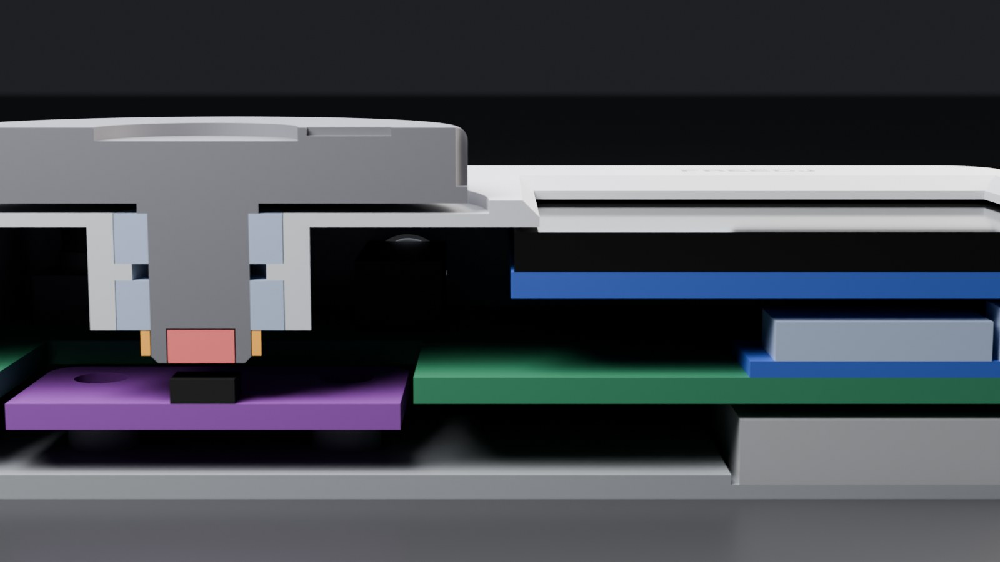
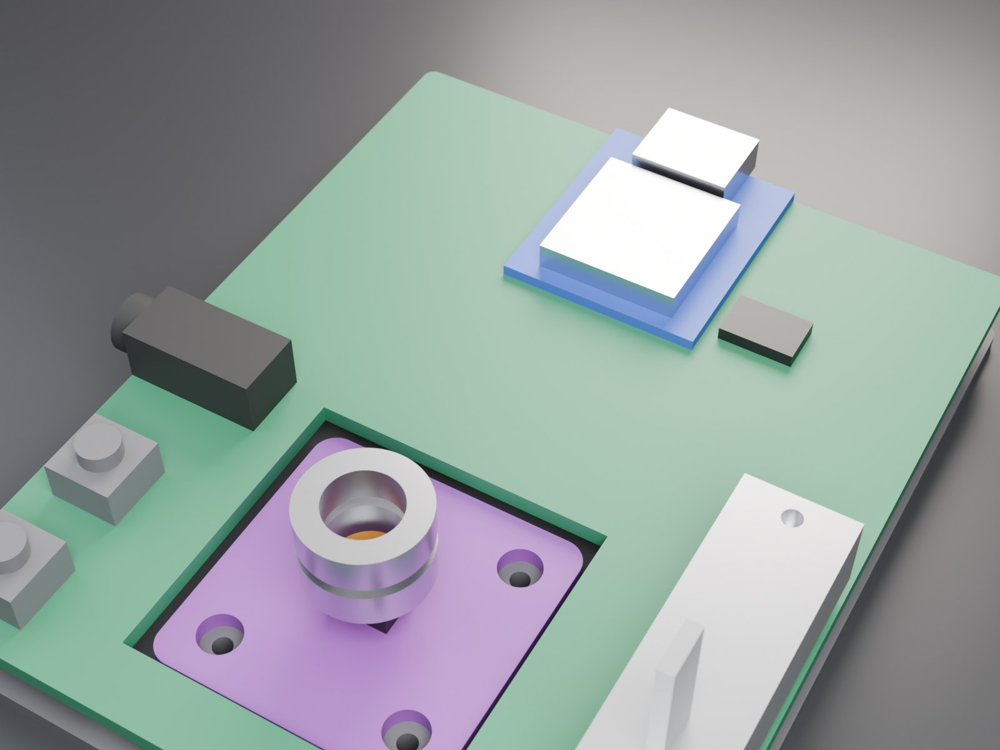
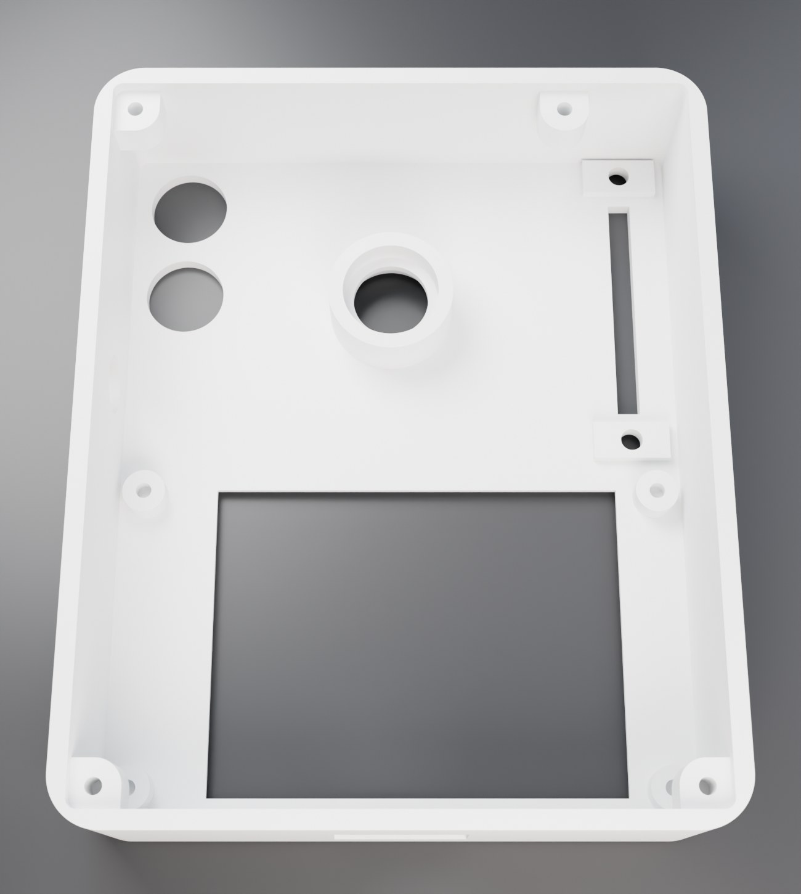

# Keychain deck

A pocket freedj deck: XIAO ESP32-S3 (plays tracks off a USB-C stick), a colour screen,
32 mm jog on an AS5600, pitch fader, CUE / PLAY, LiPo, headphone out. CDJ layout: the
screen behind the jog, CUE above PLAY in the bottom-left corner with the platter's front
edge in line with PLAY's, pitch down the right from the front edge. The jog and the screen
sit on the deck's centreline.

Two screens, picked with `make SCREEN=...` (or `KC_SCREEN=...` for the scripts):

| | `tft20` (default) | `oled095` |
|---|---|---|
| Screen | 2" ST7789 IPS, 320 x 240 (Waveshare-style 58 x 35 board), landscape across the deck | 0.95" SSD1331 OLED, 96 x 64 (generic 7-pin board), over the jog |
| Active area | 40.8 x 30.6 mm | 20.1 x 13.4 mm |
| Fader | 20 mm (35 mm frame): a longer one would run under the screen's board | 35 mm (50 mm frame) |
| Jack | left wall, between CUE and the screen | right wall, behind the fader |
| Case | **65.8 x 76 x 18.2 mm** | **60.4 x 63.6 x 16.9 mm** |

The platter stands 4.3 mm proud on both. (A keyring tab is in the CAD but switched off:
`KEYRING = True` in `params.py` adds it to the back-left corner.)

| Top | Section through the jog |
|---|---|
|  |  |
| **Inside (shell hidden)** | **Shell underside** |
|  |  |

The 2" render shows the firmware's own 320 x 240 play screen (`docs/tft_320x240.png`, from
the C6 build). The OLED renders (0015-0021) show a mock-up, since no 96 x 64 colour layout
exists yet.

The width is twice the widest half about the centreline: CUE's side of the jog, the fader's
side, or the 2" board (its active area is 1.7 mm off-centre, so centring the picture shifts the
board and adds 3.4 mm). The length
is buttons-and-jog plus the screen behind them, and the height is the screen stacked over the
XIAO. Getting much smaller needs the AS5600 (and the jog over it) on our own PCB instead of
the 23.8 mm breakout.

## Layout

| Part | Where | Notes |
|---|---|---|
| Screen | behind the jog, glass behind a chamfered window | 4 M2 bosses on its holes. 2": the 6 mm PH2.0 socket on the back must come off (it would sit on the main PCB), so wire to the 8 header holes at the left end. OLED: header on the edge toward the jog |
| Jog, 32 mm (34.5 mm well) | beside CUE / PLAY, front edge 0.5 mm behind PLAY's | printed platter + 6 mm shaft, two MR106ZZ (6 x 10 x 3), glued collar, 4 x 2 diametric magnet 1.0 mm over the AS5600 |
| AS5600 breakout (23.8 mm, freedj-esp's) | on the base under the jog, in a well in the main PCB | wires soldered straight on (no headers: they'd need 14 mm each side) |
| CUE / PLAY, 8 mm caps | stacked in the bottom-left corner, CUE on top | sized to the jog the way freedj-esp's 22 mm caps are to its 100 mm jog; 6 x 6 x 5 mm SMD tact switches |
| Fader | right side, frame 0.3 mm off the front wall | hangs from the top on 2 x M2 countersunk (on 1.3 mm pads in the taller 2" case, so its pins still reach through the main PCB) |
| XIAO ESP32-S3 | back, under the screen, flat on the main PCB | USB-C out the back wall (stick, charging, flashing) |
| 402030 LiPo | under the main PCB, under the screen | pocket in the base; XIAO's BAT pads charge it |
| PCM5102A + 3.5 mm jack (PJ-320D style) | on the main PCB | line-level out, as on the xiao-mini carrier |

Pins (XIAO S3 has 11): screen SPI SCK / MOSI / DC (CS tied low, reset on the reset line;
the 2" backlight on 3V3 or a spare pin for dimming) = 3, AS5600 I2C = 2, I2S BCK / WS / DIN
= 3, CUE + PLAY on one ADC ladder = 1, fader = 1. That's 10, leaving one spare (D6, also
the UART TX for logs while the stick is in).

## Measure before printing

Every number marked `MEASURE` in `cad/params.py` came from a listing or a drawing, not from
the parts here. The ones that move things:

- **2" screen**: from Waveshare's 2inch LCD Module drawing (board 58 x 35, M2 holes
  53 x 30, glass 47.83 x 34.60, active area 1.7 mm away from the header end, 4.0 mm from
  glass face to board back). Generic 2" ST7789 boards vary, so check yours.
- **OLED board**: size (30.5 x 27.5 assumed), hole spacing (27 x 23), where the glass and
  its active area sit on the board (centred assumed), glass + tape thickness (1.5).
- **Fader**: frame (travel + 15 long, 9 wide, 6.5 deep, by the Bourns PTA rule), screw holes
  (M2, frame - 4 apart; some have tabs instead), lever (1.2 x 4, 10 mm above the frame).
  The knob is 7.5 mm tall on the 2" case, 8.6 on the OLED one.
- **XIAO S3** height above its board (3.3 assumed for the USB-C).
- **Jack** body (12 x 6 x 5) and **LiPo** (4 x 20 x 30).

Change them in `params.py`, run `make`, and the fit check says if anything now collides.

## Print

`cd cad && make` (or `make SCREEN=oled095`) writes `cad/build/<screen>/`:

| File | Qty | Notes |
|---|---|---|
| `shell.stl` | 1 | upside down, no supports |
| `base.stl` | 1 | flat |
| `platter.stl` | 1 | upside down, shaft up |
| `collar.stl` | 1 | glue onto the shaft under the lower bearing |
| `cue_cap.stl`, `play_cap.stl` | 1 each | upside down; fill the icons with paint |
| `knob.stl` | 1 | socket down |
| `fit_gauge.stl` | optional | shaft sizes for the MR106 before printing the platter |

Hardware: 2 x MR106ZZ, 4 x 2 mm diametric magnet, 4 x M2 x 5 countersunk (base, into 1.6 mm
pilots in the shell's bosses), 4 x M2 x 4 thread-formers (screen), 4 x M2 x 4 (AS5600),
2 x M2 countersunk for the fader (x 3 on the OLED case, x 5 through the pads on the 2").

## Buttons for prototyping

The holes are 8.4 mm. Until the printed caps are done, 6 x 6 tact switches with tall round
actuators poke straight through, standing about 1.5 mm proud: 6 x 6 x 11 on the OLED case,
6 x 6 x 12 on the taller 2" one. Another option is 12 x 12 switches with their round caps, but those need
`BTN_D` set to about 12 and the buttons moved apart.

## Open items

- **Main PCB**: not designed yet. The CAD reserves its outline (the whole inside, less the
  encoder well) at 5.9-7.5 mm. It carries the XIAO, the PCM5102A, the jack, the tact
  switches and the fader.
- **5 V for the stick on battery**: the XIAO has no boost, so on the LiPo alone a USB stick
  gets no power. The main PCB needs a small 5 V boost onto the XIAO's 5 V pin (check
  Seeed's schematic first: a diode between 5 V and VBUS would block it).
- **2" backlight current** (roughly 20-40 mA) shortens battery life on the 200 mAh cell
  more than the OLED does.

## Files

`cad/params.py` holds every dimension (frame: x across, y front to back, z up from the
underside) and the screen choice. `shell.py`, `base.py`, `jog.py`, `controls.py` are the
printed parts, and `stock.py` holds stand-ins for the bought parts. `machine.py` places
everything, checks every pair of parts for overlap and exports `deck.glb`, `deck_cut.glb`
and `deck_inside.glb`. `screen_mock.py` makes the picture on the screen. `render.py` renders
them in Blender (`make renders`), and `renders/INDEX.md` is the dated render log.
