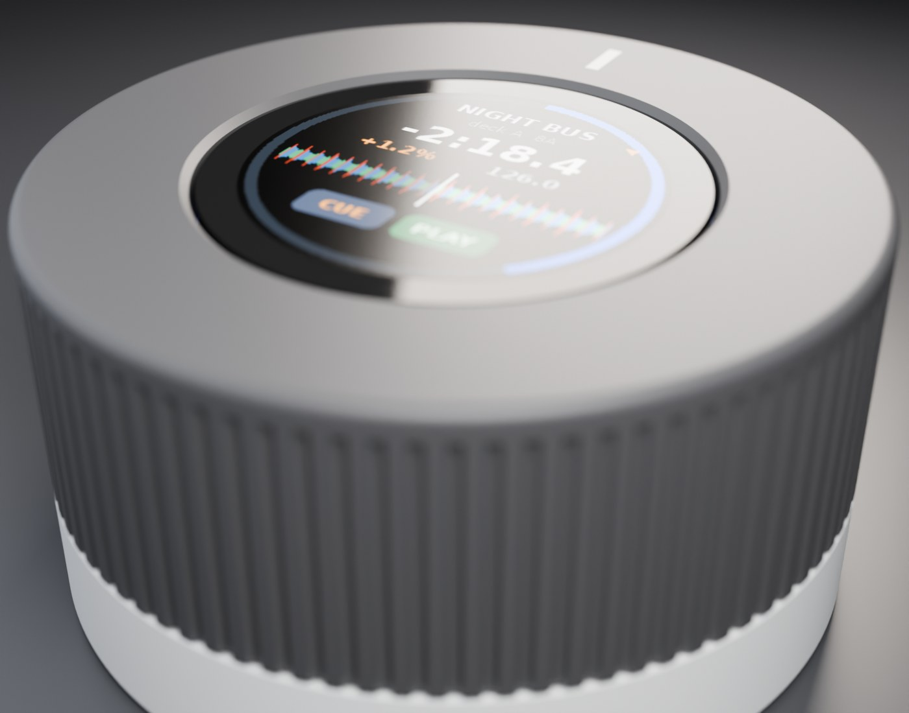
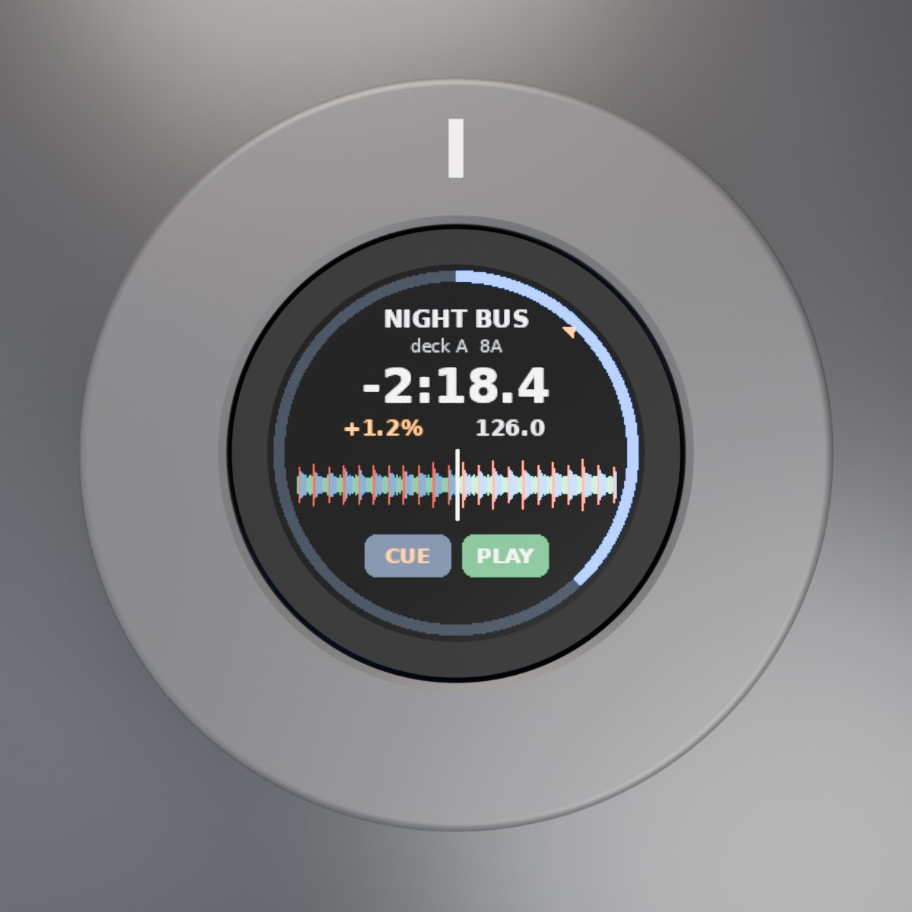
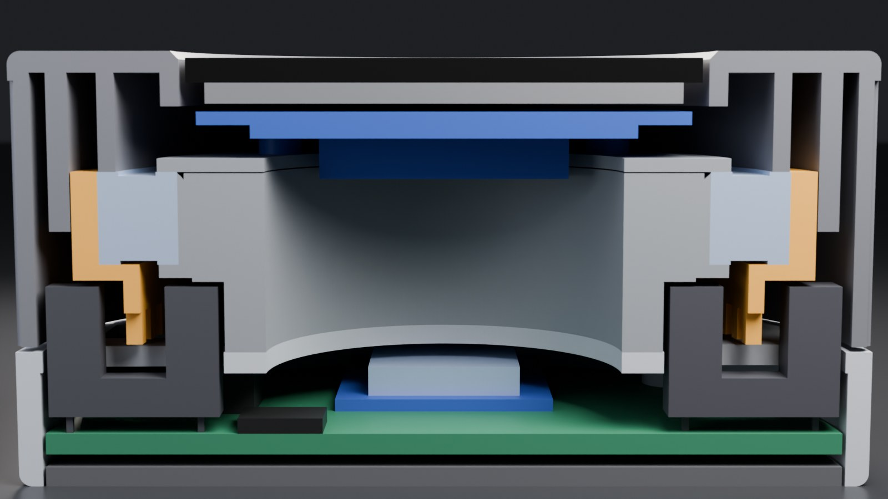
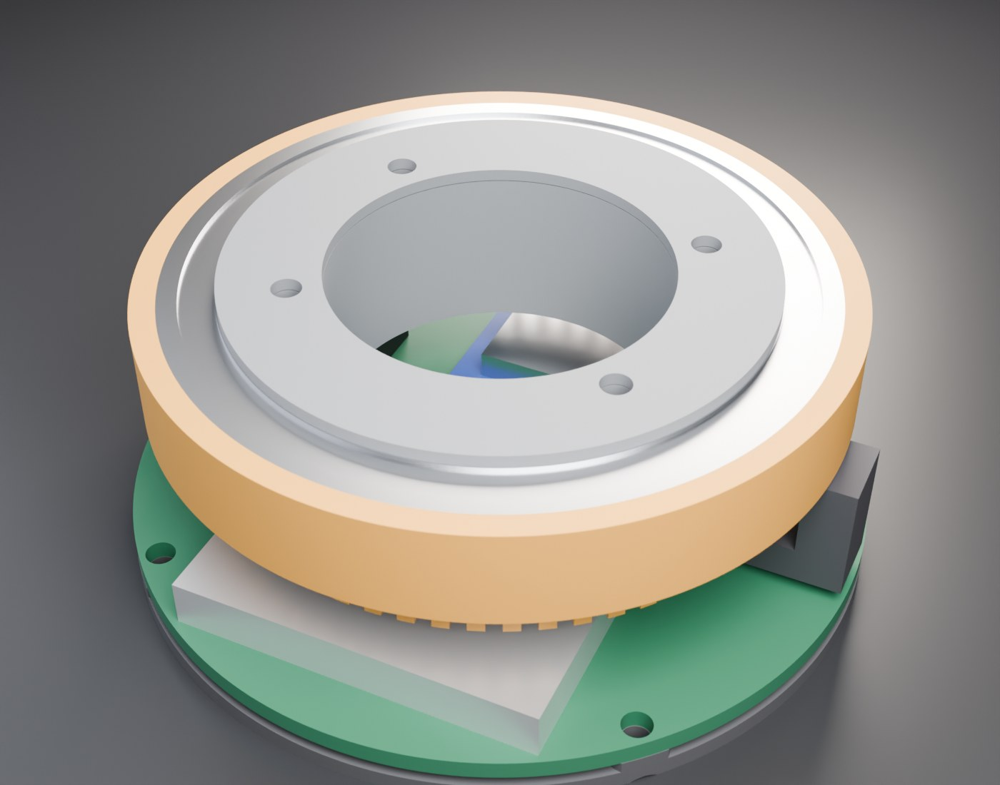

# Puck deck

A round freedj deck: a 1.28" round touch screen in the middle, and the whole top of the puck
(the ring round the glass and the knurled side) is the jog, like a Nest thermostat. Everything
else (CUE, PLAY, pitch, browsing) is on the touch screen. **65 mm across, 33.1 mm tall.**

| Top | Section through both sensors |
|---|---|
|  |  |

The picture on the screen is a mock-up (`cad/screen_mock.py`): the firmware has no round
layout yet.

## How it works

- **Screen**: Waveshare 1.28inch Touch LCD (GC9A01, 240 x 240, CST816S touch, 13-pin GH1.25).
  Its four SMT M2 standoffs sit on a printed washer on top of a printed post; screws come up
  through the post from below. Numbers are from Waveshare's 2D drawing and 3D model.
- **Jog**: one 61808 thin-section bearing (40 x 52 x 7). Its inner race sits on the post's
  shoulder, clamped by the washer; the outer race presses into the hub. The face (the part
  you touch) glues onto the hub, and its inner tube presses on the outer race from above, so
  the race is held between the hub's flange and the face. Pressing down on the jog goes
  straight through the balls into the post.
- **Encoder**: a 60-tooth comb hangs under the hub and runs through two slotted
  opto-interrupters (ITR9608-style) that stand up from the main PCB through windows in the
  deck plate, like a DJ2GO's jog. The second sensor is a quarter tooth round from opposite
  the first, so the two outputs are 90 degrees apart: quadrature, 240 counts per turn. The
  sensors are hidden under the jog, so no slot shows outside.
- **Bay**: under the deck plate, a round main PCB carries the XIAO ESP32-S3 (USB-C out the
  back for the stick, charging and flashing), a 402030 LiPo, the PCM5102A and a 3.5 mm jack
  out the left side.

Heights, bottom up: base 1.5, main PCB 2.5-4.1, XIAO top 8.4, deck plate 8.8-10.4, comb
10.9-15.9 (the sensors' tops at 15.4), bearing 17.1-24.1, washer, screen feet 25.1, glass top
32.6, jog face 33.1. The slotted sensors set most of the height: everything between the main
PCB and the bearing is there for them.

## Pins

The XIAO S3 has 11: screen SPI SCK / MOSI / DC = 3 (CS tied low, LCD and touch reset on an
RC, backlight on 3V3), touch I2C SDA / SCL + INT = 3, I2S BCK / WS / DIN = 3, jog A / B = 2.
That's all 11. Leave the touch INT off and poll it to free one.

## Measure before printing

Numbers marked `MEASURE` in `cad/params.py` came from listings, not the parts here:

- **Opto-interrupters**: body (13 x 6 x 10 assumed), slot width (5) and depth (7), and how
  far the optical axis is below the top (3). Some ITR9608 clones are only 6 mm tall: set
  `SENS_H = 6` and the puck gets 4 mm shorter.
- **61808**: the race lands (inner race OD 43.2, outer race ID 48.8) set where the washer and
  the face's press tube can touch.
- **XIAO S3** height (3.3), **LiPo** (4 x 20 x 30), **jack** (12 x 6 x 5).

Change them in `params.py`, run `make`, and the fit check says if anything now collides.

## Print

`cd cad && make` writes `cad/build/`:

| File | Qty | Notes |
|---|---|---|
| `shell.stl` | 1 | upside down (deck plate on the bed), no supports |
| `base.stl` | 1 | flat |
| `post.stl` | 1 | as is |
| `washer.stl` | 1 | flat |
| `hub.stl` | 1 | upside down, comb up |
| `face.stl` | 1 | upside down (top face on the bed) |

`BRG_FIT` in `params.py` tunes the hub's press fit on the bearing.

Hardware: 1 x 61808 (2RS or ZZ), 2 x ITR9608, 2 x M2 x 6 countersunk (post to plate),
4 x M2 x 6 socket head (screen, up through the post), 4 x M2 x 6 countersunk (base and main
PCB into the shell).

## Assembly order

The order matters: the screen screws are reached from under the deck plate, and the sensors
come up round the comb from below.

1. Post onto the shell's deck plate: 2 x M2 countersunk up from underneath.
2. Hub over the post, comb down. Press the bearing into the hub and onto the post together,
   until it sits on the post's shoulder and the hub's flange.
3. Washer, then the screen: feed its cable down the post, and put 4 x M2 up from under the
   plate (through the holes in it) into the screen's standoffs.
4. Face onto the hub, glued round the socket.
5. Main PCB up from below. The sensors come up through their windows either side of the comb.
   Plug in the screen cable.
6. Base on: 4 x M2 countersunk through the base and the main PCB into the shell's bosses.

## Open items

- **Main PCB**: not designed. The CAD reserves a 60.8 mm disc at 2.5-4.1.
- **5 V for the stick on battery**: as on the keychain deck, the XIAO has no boost; the main
  PCB needs one onto its 5 V pin.
- **Firmware**: a 240 x 240 round layout, touch for CUE / PLAY / pitch, and a quadrature jog
  driver (the C6 / S3 builds read an AS5600 now).
- **Square version**: a square screen (e.g. a 1.54" 240 x 240) with the ring round it and
  physical CUE / PLAY in the corners. The CAD is laid out from the jog axis, so it can be a
  second `SCREEN` option later.

## Files

`cad/params.py` holds every dimension (frame: x, y from the jog axis, -y toward you, z up from
the underside). `shell.py` (shell, base) and `jog.py` (post, washer, hub, face) are the
printed parts; `stock.py` holds stand-ins for the bought parts. `machine.py` places
everything, checks every pair of parts for overlap and exports `deck.glb`, `deck_cut.glb` and
`deck_inside.glb`. `render.py` renders them in Blender (`make renders`), and
`renders/INDEX.md` is the dated render log.
