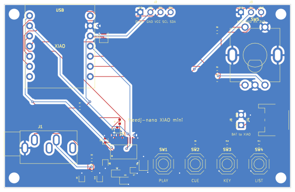

# XIAO mini player (carrier board)

A 72 x 46 mm, 2-layer carrier for a socketed **Seeed XIAO ESP32-C6**. It wires everything the
C6 firmware already expects (`firmware/main/board.h`, `CONFIG_NANO_BOARD_XIAO_C6`, OLED
layout), so it runs today's C6 build unchanged: 16-bit audio through a PCM5102A DAC.



| Block | Parts | XIAO pins |
|---|---|---|
| DAC | PCM5102A (hardware mode: SCK, FMT, FLT, DEMP to GND, XSMT pulled up), 470 R + 2.2 nF out | D1 BCK, D2 WS, D10 DOUT |
| Out | 3.5 mm stereo jack, left edge. **Line level** (into a mixer or powered speakers); the PCM5102A wants >= 1 kOhm, so headphones will be quiet and distort when loud | |
| Screen | 4-pin header for a 0.96" / 1.3" SSD1306/SH1106 I2C module: GND VCC SCL SDA | D4 SDA, D5 SCL |
| Jog / browse | EC11 (Bourns PEC11R) with push, 10k pull-ups | D8 A, D9 B, D3 push |
| Buttons | PLAY, CUE, KEY, LIST on one ADC pin: 10k pull-up, 0 / 2k2 / 4k7 / 10k to GND (the firmware's `LADDER_MV`) | D0 |
| MIDI in | 3-pin header GND RX 3V3, for the bridge's UART | D7 |
| Battery | JST-PH LiPo socket, right edge, plus two pads beside it: wire them to the BAT pads under the XIAO (it has the charger) | |
| Spare | | D6 |

USB-C (the XIAO's) leaves the top edge. Four M2 holes in the corners.

## State

Routed and checked: 0 shorts, 0 open nets, KiCad DRC clean under JLCPCB rules, DFM (hole
spacing, via sizes) clean, no floating pads. `fab/` has Gerbers, drill, CPL and BOMs for JLCPCB
(assembled: DAC, passives, jack, JST, EC11, buttons) and PCBWay. Not built yet.

**Check before ordering:**
- **Jack pinout.** No datasheet drawing for the PJ-325C5-G was found. The board assumes pin 1
  sleeve, 2 tip (L), 3 ring (R) (`JACK_PIN` in `index.circuit.tsx`). Check the part (a
  multimeter on a sample, or the drawing) or swap in a jack you know.
- **OLED header order.** GND VCC SCL SDA is the common one, but some modules are VCC GND.
- **R2 / R3 (470 R)** have no LCSC number yet (in the hand-solder list): pick one at order time.
- **XIAO row spacing** (15.24 mm) and the JST's polarity against your batteries.

## Rebuild

```
npm ci                                   # tscircuit, pinned by package-lock.json
bash scripts/route2.sh                   # export, outline gate, GND pour, route (Freerouting + srj), DRC
bash scripts/make_fab.sh index.circuit.kicad_pcb freedj-nano-xiao-mini both
```

The source of truth is `index.circuit.tsx` (placement in code); `index.circuit.kicad_pcb` is the
routed result. Parts: `imports/` (JLC footprints), `lib/Xiao.tsx` (the socket),
`lib/GndVia.tsx` (stitching vias for the DAC's tie-low pins, as parts so the router keeps them).
Scripts are the pcb-layout skill's.

## Other XIAOs

The S3, C3 and RP2040/RP2350 XIAOs have the same pinout and fit the same socket; the firmware
needs a pin map for each (the S3 one would follow freedj-esp's S3 port).
